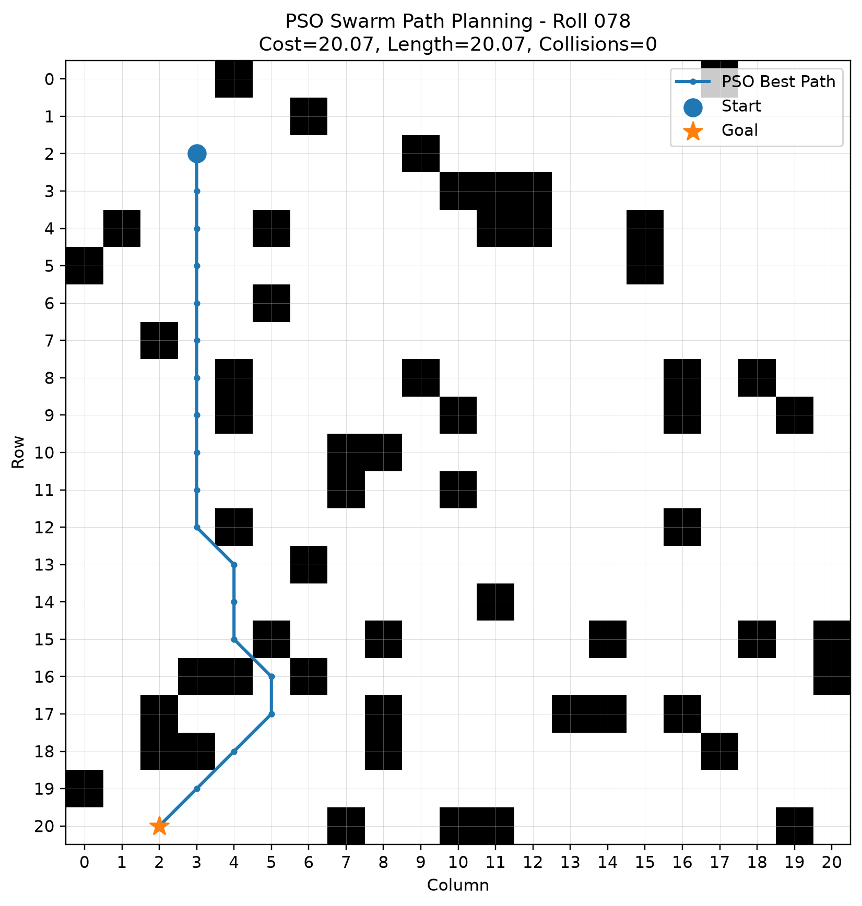
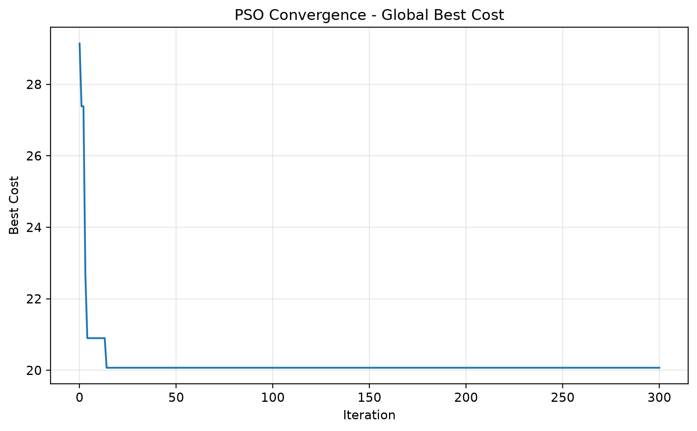

# Swarm-Based Path Planning with Obstacles — Roll 078

**Student:** Obaidullah Shahid
**Roll Number:** 078  
**Random Seed:** 78  
**Course:** Swarm Intelligence Lab  
**Assignment:** Assignment 1 — Swarm-Based Path Planning with Obstacles

## Objective

This project implements **Particle Swarm Optimization (PSO)** to search for a short path from a randomly generated start cell to a randomly generated goal cell on a 2D grid while avoiding obstacles.

The problem instance is generated programmatically using my roll number as the random seed:

```python
ROLL_NO = 78
SEED = ROLL_NO
random.seed(SEED)
np.random.seed(SEED)
```

Therefore, the grid size, number/positions of obstacles, start point, and goal point are reproducible for roll number **078**.

## Generated Problem for Seed 78

Running the supplied code with seed 78 generates:

- Grid size: **21 × 21**
- Obstacles: **55**
- Start cell: **(2, 3)**
- Goal cell: **(20, 2)**

These values are **not manually hardcoded** as the problem instance. They are produced by the seeded generation section of `main.py`.

## PSO Approach

Each particle represents five intermediate 2D waypoints between the fixed start and goal.

A particle has the form:

```text
[r1, c1, r2, c2, r3, c3, r4, c4, r5, c5]
```

The route is:

```text
Start → W1 → W2 → W3 → W4 → W5 → Goal
```

The straight segments between these waypoints are converted to grid cells using Bresenham's line algorithm.

The fitness function minimizes:

```text
Fitness = Path Length + Collision Penalty
```

Each obstacle collision adds a large penalty, so PSO strongly favors collision-free solutions.

The standard PSO equations used are:

```text
v(t+1) = w*v(t)
         + c1*r1*(pbest - x(t))
         + c2*r2*(gbest - x(t))

x(t+1) = x(t) + v(t+1)
```

Main parameters:

- Particles: 80
- Iterations: 300
- Inertia weight `w`: 0.72
- Cognitive coefficient `c1`: 1.50
- Social coefficient `c2`: 1.50
- Intermediate waypoints: 5

## Result

For seed 78, the supplied run produces a collision-free route.

The exact run details are saved in:

```text
outputs/run_summary.txt
```

Main visualization:



Convergence graph:



## How to Run

### 1. Clone or download this repository

Open the project folder in VS Code.

### 2. Create a virtual environment (optional but recommended)

Windows:

```bash
python -m venv .venv
.venv\Scripts\activate
```

### 3. Install dependencies

```bash
pip install -r requirements.txt
```

### 4. Run the program

```bash
python main.py
```

The program prints the generated problem and best path, then saves:

```text
outputs/pso_best_path.png
outputs/pso_convergence.png
outputs/run_summary.txt
```

## Hand-Drawn Flow Diagram

The assignment requires a photo of a hand-drawn flow diagram.

After drawing the diagram using `DIAGRAM_GUIDE.md`, take a clear photo and save it inside this repository as:

```text
images/hand_drawn_flow_diagram.jpg
```

Then replace the temporary line below with:

```markdown

```

**Hand-drawn diagram photo goes here before final submission.**

## Repository Structure

```text
swarm-pathplanning-078/
│
├── main.py
├── README.md
├── requirements.txt
├── DIAGRAM_GUIDE.md
├── .gitignore
│
├── images/
│   └── put-hand-drawn-photo-here.txt
│
└── outputs/
    ├── pso_best_path.png
    ├── pso_convergence.png
    └── run_summary.txt
```

## Suggested Git Commit History

The assignment requires at least five meaningful commits. A suitable sequence is:

```text
1. Initial project setup and seeded grid generation
2. Add obstacle start and goal generation
3. Implement PSO velocity position and fitness logic
4. Add collision checking and path visualization
5. Add outputs README and hand drawn diagram instructions
6. Add final hand drawn flow diagram photo
```

## Short Viva Explanation

This project uses Particle Swarm Optimization for path planning. I used roll number 078 as random seed so my grid, obstacles, start, and goal are unique and reproducible. Each particle stores five intermediate waypoints. The fitness function combines route length with a large obstacle collision penalty. During every PSO iteration, particle velocity and position are updated using inertia, personal best, and global best. The best collision-free path is plotted on the grid and saved as an image.
